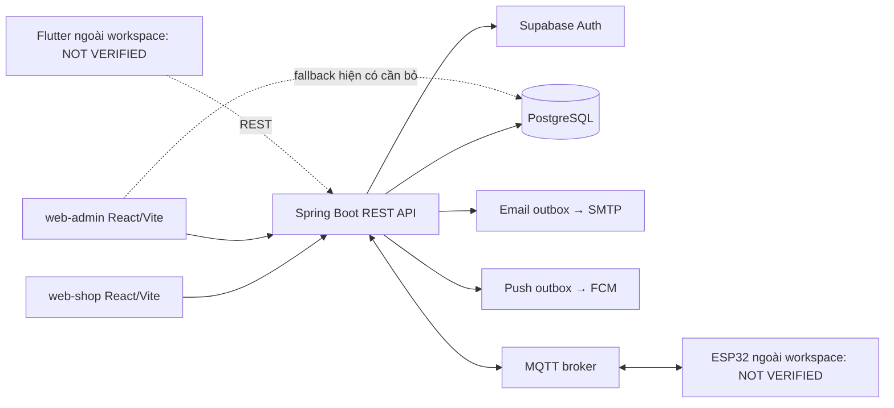

# 00 — Tổng quan dự án

## Mục lục

1. Sản phẩm và actor; 2. Kiến trúc; 3. Phạm vi xác minh; 4. Quyết định bàn giao.

## Sản phẩm và actor

SmartBox bán thiết bị IoT: Base có khóa điện tử/trạng thái/điều khiển; Pro thêm Loadcell + HX711 theo quyết định prompt. Mỗi dòng có S45L/M85L/L150L. Đây là đặc tả catalog, không là dữ liệu đã seed trong database. Source chỉ hỗ trợ metadata size/capacity và has_weight_sensor; ProductResponse chưa expose capability này. Không suy diễn Pro chỉ từ tên tùy ý trong DB.

Guest tìm hiểu/chọn cấu hình; customer mua/giải trình ticket/xem thiết bị; super_admin quản trị; product_manager catalog/CMS; support_agent order/ticket/customer; accountant reports/refund; technician thiết bị/bảo hành và **vai trò dự kiến** giao+lắp đặt. Không có role DELIVERY_INSTALLER trong enum hiện tại. Người giao và người lắp là cùng nhân viên nội bộ, không app shipper riêng.

## Kiến trúc hiện tại

Java21/Spring Boot3.4.3/Gradle9 wrapper; controller/service/repository/JPA + JdbcTemplate SQL cho locks/aggregates. `BackendApplication` EnableScheduling; jobs/mail/MQTT/FCM bật bằng environment. Supabase Auth giữ auth.users, profiles giữ role/locked trong PostgreSQL. Không có backend register/me/address APIs; public account provision/profile cần contract bổ sung.

Migrations SQL thủ công 001/002/003, JPA ddl-auto=none. Không có Flyway/Liquibase runner ở source hiện tại, dù requirements gốc nói changesets. Không dùng ID LONG hoặc enum uppercase từ ví dụ requirements cho JSON order thật.

## Ba domain độc lập

| Domain | Mục tiêu | Trạng thái hiện tại |
|---|---|---|
| Ecommerce | Order/items/kho/thanh toán/duyệt | IMPLEMENTED provider mock |
| Công ty giao + lắp | Assigned worker, tiến độ, kiểm tra, nghiệm thu | PLANNED; chỉ shipment cũ và sale link hiện hữu |
| IoT nhận bưu kiện | Sensor→package_detected→lịch sử/push | IMPLEMENTED adapter; hardware delivery NOT VERIFIED |

Order COMPLETED hiện tại là đã shipment delivered đủ serial, **chưa** là nghiệm thu khóa/cảm biến. Luồng mục tiêu chuyển completion sang acceptance của Delivery Installation: đây là backend gap cần sửa riêng, không được frontend tự giả.

## Bằng chứng và mức xác minh

Đã đọc 175 Java files, controller/DTO/security/service + migrations/tests/config; inventory ở validation/source-evidence.json. Swagger runtime 114 operations chạy bản jar đã build trong H2 RAM/profile demo; chỉ xuất metadata, không business DB. Kết quả trước nhiệm vụ tài liệu: 50 tests pass/1skip trên H2 và PostgreSQL cô lập (backend/docs/FINAL_REVIEW.md + XML). Không chạy lại toàn bộ tests trong nhiệm vụ này, không dùng kết quả cũ để tuyên bố mọi API E2E/firmware đã pass.

Trong workspace có web-shop/web-admin; không có Flutter/firmware/asset sản phẩm đã chứng minh. Chủ đề “phản hồi mở khóa <1 giây” của đề cương là mục tiêu nghiệm thu, chưa có đo thật. Không quảng cáo IP65/solar/OTA/FaceAI/24 tháng nếu chỉ thấy trong frontend mock.

## Hợp đồng bàn giao

Đọc [06](06-API-CONTRACTS.md) cho API thật, [17](17-BACKEND-GAP-ANALYSIS.md) cho blockers và [DESIGN](DESIGN.md) cho giao diện. API production URL trong OpenApiConfig là nhãn cấu hình, không chứng minh domain đã triển khai; frontend cấu hình base URL theo môi trường. Không thay frontend/backend/database trong nhiệm vụ này.
