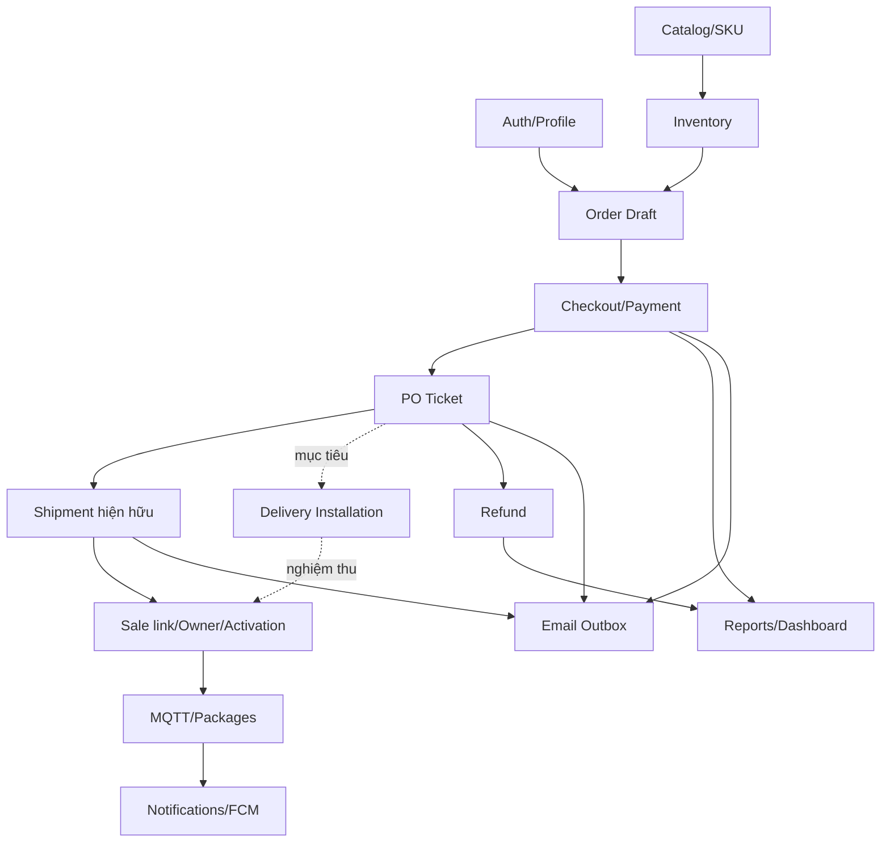

# 02 — Module specifications

## Mục lục

Catalog; commerce; fulfillment; customer/admin; IoT; reporting; dependency map. Chi tiết field/API ở [06](06-API-CONTRACTS.md), rules ở [07](07-BUSINESS-RULES.md).

| Module | Actor/chức năng | Input/output và source | Dependency/giới hạn |
|---|---|---|---|
| Auth | Guest login, mọi actor refresh/logout | AuthController → AuthService → SupabaseAuthGateway; session tokens + flat profile id entity | Profiles UUID phải tồn tại; locked denied; register/me chưa có; no demo-password bypass |
| Catalog | Guest list/category/variants; product_manager CRUD | ProductController/ProductService; ProductResponse/VariantResponse | Giá=product.price+price_delta; public active filtering chưa cưỡng chế; size nullable |
| Inventory | Quản lý kho SKU/guard reservation | VariantInventoryService.adjust; OrderWorkflowService.moveStock/release | Delta kho theo SKU; negative denied; product stock legacy không dùng bán SKU |
| Cart/Draft | Customer chọn SKU/qty/address, CRUD order item | CreateOrder → OrderWorkflowService; view snapshot + expiry | Local cart chưa reserve; tạo draft mới reserve; max99 perSKU,100 input entries; create không idempotency |
| Checkout | Customer khóa draft, nhận paymentURL | PaymentService.checkout; checkout_keys/payments | Key24h, mock-only; paymentURL JSON demo endpoint, không hosted payment UI |
| Payment processing | Gateway mock/backend HMAC | callback: SUCCESS/FAILED; payment/order/history/ticket/outbox atomic | Public callback authenticated HMAC; frontend không sign; late→refund_required |
| PO Ticket | support/super review; customer explanation | ApprovalTicketService.act/detail/list; ticket/history/review_round | One ticket/order, order paid items immutable; no file attachments/extra address edit |
| Refund | Accountant đối soát | FulfillmentService.refunds/completeRefund; providerRef | Chỉ ghi nhận hoàn tiền, không chuyển tiền; customer chưa có refund detail API |
| Shipment hiện hữu | Support/super ship/deliver, technician serial attach | FulfillmentService → shipments/history/devices | Shipment delivered hiện complete order; carrier/tracking legacy, không installation job |
| Delivery Installation mục tiêu | Admin phân công, cùng technician giao+lắp/nghiệm thu | PROPOSED delivery_installations/job history/acceptance | PLANNED, backend blocker; assigned-only staff; không GPS/carrier/appshipper |
| Device sale/activation | Staff register/link; customer activate | DeviceWorkflowService/FulfillmentService | Device product_variant_id đúng item; owner sau delivered; activation cần completed |
| IoT control | Owner LOCK/UNLOCK/TARE | DeviceWorkflowService.command → AFTER_COMMIT MQTT; MqttDeviceService ACK | Enabled+online+activated; no acceptance access for installer currently; timeout≠failed physical action certainty |
| Telemetry/package | Firmware status/sensor; owner readings/packages | MqttDeviceService.message, sensor_readings/delivery_packages | Topic binding + brokerACL; Base ignores weight; event transition dedup not QoS global dedup |
| Notifications | Owner preferences/read/token | NotificationController/PushNotificationService/FcmWorker | PACKAGE_DETECTED only; FCM external NOT VERIFIED; no customeremail failure status |
| Warranty | Staff lookup/claim list/assign/status/notes | WarrantyController/WarrantyService | No warranty issuance/customer claim API; technician mutation assigned-only nhưng list toàn bộ vẫn broad |
| Customer admin | Support/super list/360/lock; super role/staff | UserController/UserService | DefaultAddress đơn lẻ; createStaff admin provider; recover email link, OTP verify503; search server thiếu |
| Content admin | Product_manager/super articles/banner/review/FAQ | ContentController/ContentService | Staff-only; Blog/FAQ public cần API read-only; HTML sanitation/validation còn partial |
| Promotions | Product_manager CRUD/validate | PromotionController/PromotionService | Customer validate403; total client chỉ tính minh họa, không workflow discount |
| Config | Super templates/system read | SettingsController/SettingsService | Metadata DB template≠Thymeleaf outbox; shipping/payment/categoryCRUD thiếu |
| Audit | Super/accountant read; backend business record | AuditLogService/CommerceRepository.audit | Actor server principal; no UI own audit POST for payment truth; legacy coverage partial |
| Revenue | Accountant/super ParamSet/export | RevenueReportService OpenPDF/POI | UTC+7paidAt, typed params, max92 daysmetadata; cancelled excludesorderrevenue; cashflow separate |
| Dashboard | Accountant/super KPI/partial | ConcurrentDashboardService; legacy DashboardService | Four parts concurrent; failed parts null; not all widgets newAPI; no public economic data |

## Dependency theo nghiệp vụ

Dotted flow là mục tiêu chưa code. Frontend Phase1 dùng catalog/draft/checkout/ticket thật với feature flags; giao+lắp phải đợi API job, không chọn flow shipment cũ rồi gọi là installation.
