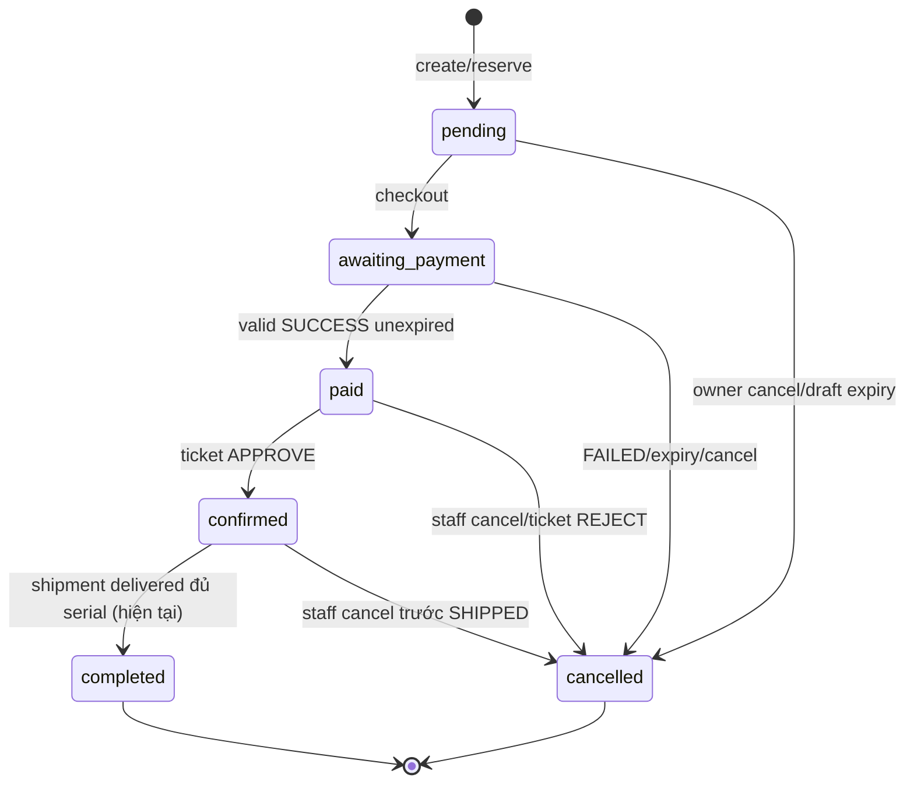
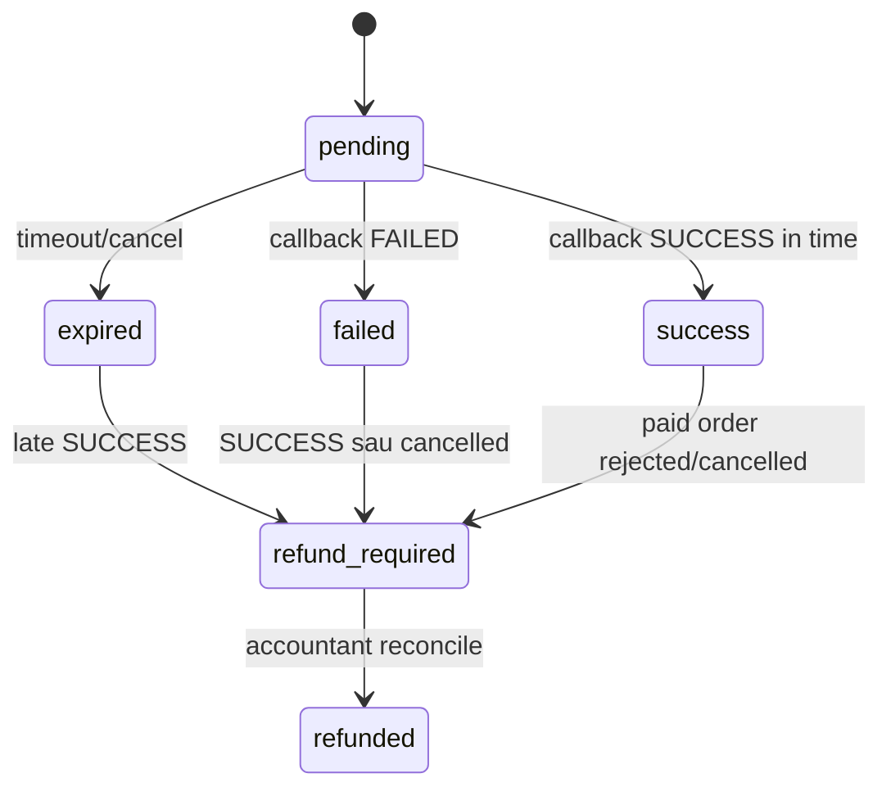
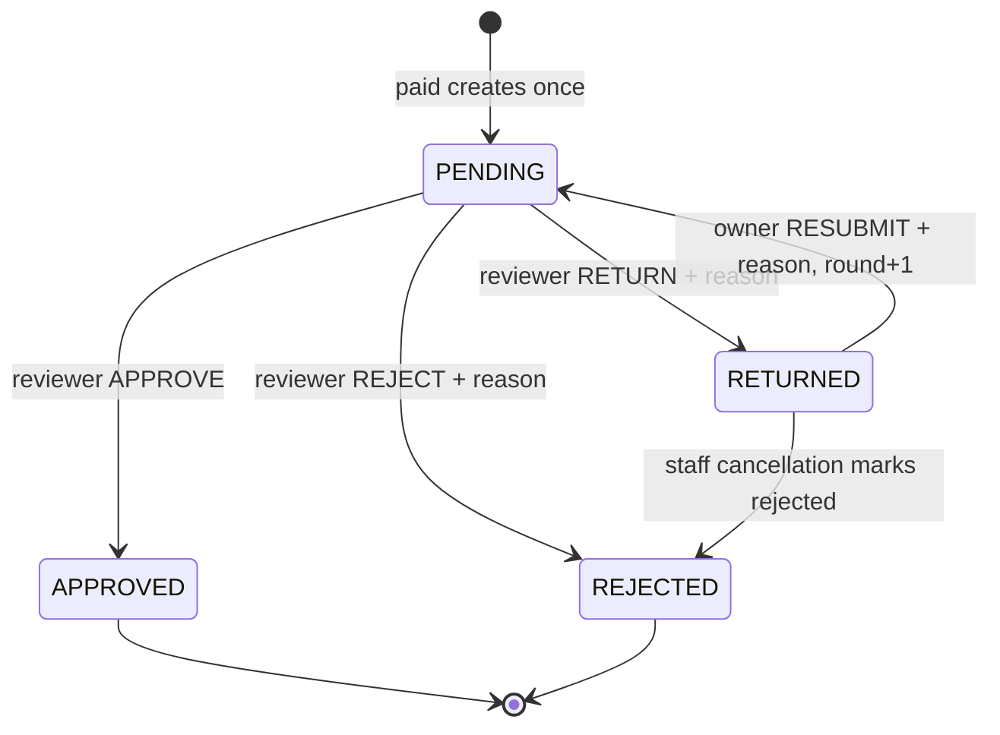
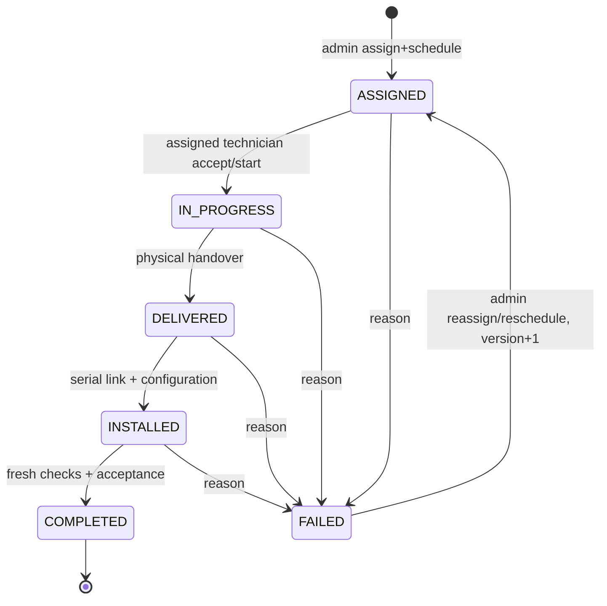

# 04 — State machines

**Cập nhật DeliveryInstallation:** phần giao/lắp đặt PLANNED trong snapshot này đã được triển khai. Xem [cập nhật và hợp đồng hiện tại](DELIVERY-INSTALLATION-IMPLEMENTED.md).

## Mục lục

Order; Payment; Ticket; Refund; Shipment; Delivery Installation; Device/Command; Package. Literal wire casing giữ đúng source.

## Order — IMPLEMENTED, OrderStateMachine

Wire lowercase. History created row có from_status null; changed_by UUID string hoặc SYSTEM. cancelled+lateSUCCESS không chuyển Order, tạo refund. Legacy processing/shipping/delivered/refunded vẫn có enum/dữ liệu, không tự normalize sangcorestates/mutationworkflow2. Completed hiện không nghiệm thu; target thay trigger bằng job acceptance, không đổi source trong nhiệm vụ tài liệu.

| Trạng thái | Customer UI | Allowed action |
|---|---|---|
| pending | Nháp/giữ kho có expiry | items mutate,checkout,cancel |
| awaiting_payment | Chờ thanh toán | refresh/cancel trước paid; không sửa item |
| paid | Đã thanh toán/chờ duyệt | xemTicket; resubmit nếu RETURNED; cancelquaCSKH |
| confirmed | Đã duyệt/chờ thực hiện | tracking; jobtracking chưa API |
| completed | Đã hoàn thành shipment hiện tại | deviceactivation; không claim installationverified |
| cancelled | Đã hủy | xemhistory/tạo order mới; refund chỉ khi backend xác minh |

## Payment — IMPLEMENTED, PaymentService/FulfillmentService

Wirelowercase. FAILED/expired order cancelled, inventoryrelease một lần. success/refund_required/refunded callback lặp ACK; “success”≠“confirmed”; refund_required≠đã hoàn. Customer OrderView không expose paymentstatus/refund riêng; paidAt và status không đủ để xác định failedvsexpired → backendgap.

## PO Ticket — IMPLEMENTED, ApprovalTicketService

Wireuppercase. Act method requiresorderpaid for decisions. Cancel staff onlyupdatesPENDING/RETURNED ticket; cancel confirmed canleaveticketAPPROVED whileOrdercancelled → UI phải táchhai trạng thái, không ép đồng nhất. History actionCREATED/APPROVE/RETURN/RESUBMIT/REJECT/CANCELLED.

## Refund — IMPLEMENTED recording

PENDING→COMPLETED (`completeRefund` providerRef); same providerref repeatACK no mutation; differentref409. Unique payment_id, provider_ref. No automatic refund provider or customer refundAPI; completion isstaffattestation. Source migration002 check statuses.

## Shipment — IMPLEMENTED legacy

PREPARING→SHIPPED→DELIVERED; shiprequiresorderconfirmed, deliverrequiresdevicesexactqty; trackingcaneditpreDELIVERED. No FAILED status. Source `FulfillmentService`, `shipments/shipment_history`. Đây không là DeliveryInstallationstatus.

## Delivery Installation — PLANNED state machine, endpoints PROPOSED

Onejob/order MVP, oneemployee giao+lắp. Eachtransitionhistoryactor/timestamp/reason. Retry không xóa old history/evidence, currentattempt dùng evidence mới. JobCOMPLETED+OrderCOMPLETED+outbox cùng tx; completerepeatkey no duplicates. PhysicalDELIVERED cannot imply warranty/stock return orinstallationacceptance. Không code hiện tại đáp ứng gate này.

## Device và command — IMPLEMENTED primitives

Device.status online/offline/maintenance/error là health, owner_id/sold_order_item_id/activated_at là lifecycle riêng: unassignedserial→soldlink→ownerondelivered→activation→IoT. Không enum REGISTERED/INSTALLED trong entity; frontend không đưa vào status field. ManualstatusAPI không chứng minh physical online; showlastSeen.

CommandPENDING→SENT→ACKNOWLEDGED hoặc FAILED; PENDING/SENT→TIMED_OUT khi10s/3attempts; oldrowLEGACY không được replay. ACK payload commandId/resultSUCCESS/FAILED, device/topicmatching, claimstatusSENT và expires. MQTTQoS1 duplicate cần firmware dedupcommandId. Expired command mayhavephysicaleffectwithoutACK; UI không assertlocked/unlockedfromtimeout.

## IoT Package — IMPLEMENTED

DELIVERED→COLLECTED do sensor true→false. No SKU/payment/usercommercialorder; package belongsdevice. Uncertain detectionneedsfirmwarecalibration; không hứa chống mất cắp/weightaccuracy nếu chưa có test hardware.
