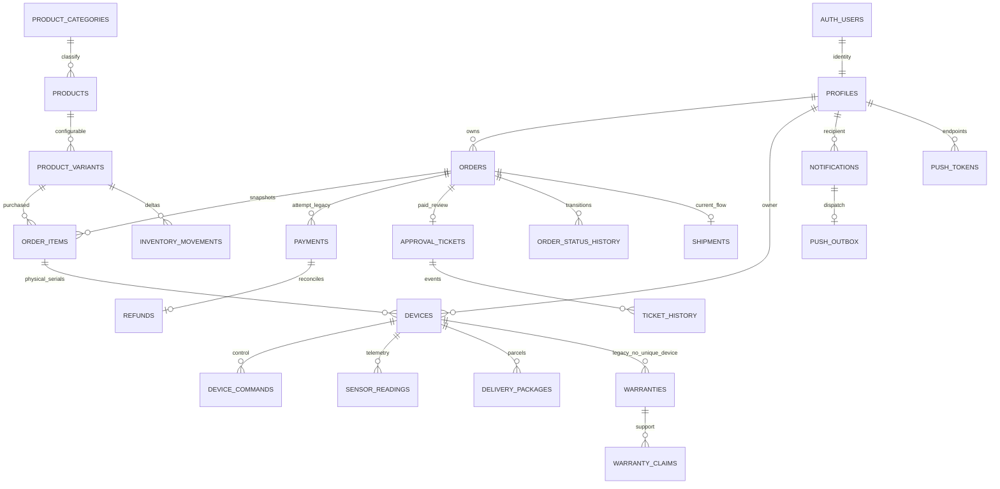

# 05 — Database/domain model

## Mục lục

Domain boundaries; ERD; constraints; migrations; proposed installation model. Source: database.sql, entities và `backend/src/main/resources/db/migration/001–003`.

ERD dựaFK/domain, **không** nói warranty one/device vì DB cũ không unique; repositoryfindByDeviceIdOptional có risk duplicate. Auth-users/profiles optional profile missing bị401. Payment mới one/order via partialuniqueindex(expires_at notnull), legacy có many payments. Saleitem→devicesqtyexact là service guard, không SQL count constraint.

| Domain/table | Keys/columns quan trọng | Cardinality/invariant |
|---|---|---|
| products | UUID/category/price/sku/imagesjsonb/has_weight_sensor/is_active | Product sku legacy; sellableSKUởvariant, capability không DTO public |
| product_variants | UUID/product_id/sku unique/price_delta/stock_quantity/size/capacity/is_active | price=base+delta; stock>=0; capacity>0; sizecapacityruleJava không DB enum |
| orders | UUID/user_id/status enum/total/address/paid_at/expires_at/workflow_version/inventory_released | v1 legacy readmanualreview; v2 reservation; releaseflagexactlyonce |
| order_items | UUID/order/product/variant/qty/unit_price + sku/name/size/capacitysnapshots | unique(order_id,variant_id),qty1–99checkNOTVALIDlegacy; price>=0 |
| checkout_keys | keyPK/orderFK/paymentFK/response/expiry | key<=128,24h; response immutable onvalidreuse; ownercheck |
| payments | UUID/order/amount/status/provider/paid_at/expires_at | one workflowpayment/order; status text noenumguardDB |
| order_status_history | UUID/order/from/to/changed_by/reason/time | actorUUIDstring hoặc SYSTEM; transactionwithchange |
| inventory_movements | UUID/variant/order optional/delta/reason/actor/time | manuallyadjustorderNULL; reservation deltas; do notexposeDBwriteclient |
| approval_tickets | UUID/order unique/status/review_round/reason/time | PENDING/RETURNED/APPROVED/REJECTEDconstraint |
| ticket_history | UUID/ticket/action/actor optional/reason/time | eventUUID usedforemaildedup repeatedrounds |
| refunds | UUID/payment unique/order/amount/status/provider_refunique/time | PENDING/COMPLETED; monetaryrecordnotprovidertransfer |
| email_outbox | UUID/template/reference/event_key unique/payload/recipient/status/attempts/next/claim lease | statusesPENDING/SENT/FAILED; event-baseddedupforreviewround |
| shipments | UUID/order unique/carrier/tracking/status/time | PREPARING/SHIPPED/DELIVERED; notinstalled |
| devices | UUID/product/variant/serial/topic/owner/solditem/activated/status/lastSeen | MQTTprefixuniqueexceptnull; serialconstraintexisting; ownernotselfclaim |
| commands | UUID/device/requested_by/request_key/status/attempts/expiry/ack/error | unique(device,user,key),boundedretry; no manualstatecompletion |
| sensor_readings | UUID/device/weight/distance/door/rawjsonb/time | observeddata; Baseweightexcluded |
| delivery_packages | UUID/device/weight/detected/collected/status | parcelsindependentcommercialorder |
| notifications/preferences | user/device/event/enabled/is_read | owneraccess; PACKAGE_DETECTED optout |
| push_outbox/deliveries | notification/claim/status + notification/token unique success | externaldeliveratleastonce,skipknowntokensuccess |
| report_definitions/params | codePK/querySQL; paramname/type/required/maxdays | bound values,DBAtemplateonly,metadata seedednotbusinesssamples |
| warranties/claims/policies | device/order item/start/end/claim status/assignee; category/duration | noautocreationatdelivery; duplicate policy ambiguitynotresolved |

Content/article/banner/review/FAQ, promotions, message_templates, shipping_methods/payment_methods, audit_logs, device_events giữ entity hiện có; response typed ở DTO dictionary. Không centralCarttable: draftOrder thayservercart; localcart chỉ client intent.

## Migrations hiện tại

001 thêmorderenum awaiting_payment/paid và commit riêng. 002 commerce additive có preflight dupe/negativestock, snapshots/checks/indexes/tables. 003 IoT additive. Không chạy lên DB user trong nhiệm vụ; operatorbackup và review trước. Không backfill paid_at/snapshot/kho legacy tự động. Frontend không dùng PostgREST để sửa orders/payments/inventory/tickets/outboxes; quyền/RLS remote chưa được đối chiếu.

## Delivery Installation đề xuất (chưa tồn tại)

`delivery_installations`: idUUID,order_idUNIQUEFK,assigned_toFKprofiles,statusCHECKsixstates,scheduled_at,started_at,delivered_at,installed_at,completed_at,installation_note,failure_reason,version integer,attempt integer,created_at/updated_at. `delivery_installation_history`: actor/status/from/to/reason/time/version. Evidence theo mỗi device và attempt: sold_order_item_id/device_id/serial/topic,lasttelemetry,lockcommandid+ACK,weightcheckPro,customer acceptance/time/technician. Không lưu Fire base/SMTP/Brokersecrets trong evidence.

Onejob/order như ng job chứa all serials cho quantity>1. Assignee active technician,assigned-onlydetails. Proposal cần migration04 tươnglai, unique&versionlock, restrictions theo job không toàn hệ thống. Các endpoint/table ở [PROPOSED](contracts/PROPOSED-API.md), không bổ sung vào OpenAPI thật.
