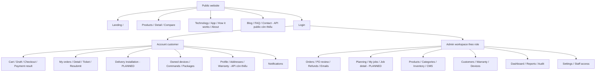
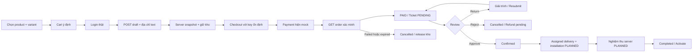

# 14 — Sitemap, screen inventory và wireframes

Route dưới đây là route frontend đề xuất; API xem [06](06-API-CONTRACTS.md). Bản chỉnh sửa và chuyển màn hình tại [wireframes.html](preview/wireframes.html). Chưa có Figma. Screen inventory và trạng thái API đầy đủ ở [10](10-FRONTEND-REQUIREMENTS.md).

## Sitemap / navigation

Header public: logo, sản phẩm, công nghệ, cách hoạt động, tài khoản, CTA khám phá. Mobile drawer giữ các mục này, Escape/backdrop đóng. Account: đơn hàng, thiết bị, thông báo, profile; feature thiếu có label hoặc ẩn, không link trang trống giả hoàn chỉnh. Admin sidebar theo role từ server, nhưng backend vẫn kiểm tra quyền; technician chỉ khu vực kỹ thuật và MyJobs khi API mới sẵn sàng.

## Customer flow

Payment query string không quyết định H. Chưa có summary payment/refund cho customer; UI không phân biệt chính xác mọi nhánh chỉ từ Order.status. Return không mở chỉnh sửa item đã trả tiền. User rời trang rồi quay lại mở MyOrders/detail, không tạo draft mới mặc định.

## Wireframes cấu trúc

| Screen | Desktop layout | Mobile layout | Primary action / data dependency |
|---|---|---|---|
| Landing | Header; headline + product sân khấu liền nền; CTA; sections | Header; text; visual; controls; CTA | Khám phá; catalog/asset không chặn content tĩnh |
| Product detail | Visual7/12 + selector5/12; compare bên dưới | Visual→selector→price→CTA sticky | Add variant; required UUID/stock/finalPrice |
| Cart/draft | Items8/12; totals4/12; expiry ở header | Items→address→total→CTA | Create draft hoặc edit pending; không có coupon/fees giả |
| Checkout | Title+stepper; address/read-only snapshots; payment action | Một cột, keyboard tốt, bottom summary | Checkout key; không chọn COD hiện chưa tích hợp |
| Payment result | Status lớn; reason; order link; poll hint | Status→action, không spinner vô hạn | GET detail; unknown outcome cho retry read |
| MyOrders | Filter UI hỗ trợ thực tế; rows date/total/status/action | Cards cùng fields, load-more | Open actual order; array không total |
| Order detail | Header status; items; timeline; ticket; shipment/job riêng | Status→next action→items→events | Resubmit khi RETURNED; theo dõi job chỉ khi API có |
| PO review | Paid snapshot trái; ticket/history; action bar phải | Summary→reason→decision buttons | Approve/Return/Reject; confirm và409 reload |
| Planning PLANNED | Confirmed queue; assigned technician/date form; job timeline | Queue cards và sheet assign | Một technician giao+lắp; không carrier/GPS |
| MyJobs PLANNED | List ngày/status/customer minimal + detail | Cards44px actions, gần lịch đầu | Open assigned-only job; server scope |
| Job detail PLANNED | Vertical progress trái, current-stage form phải | Sticky next action dưới, progress cuộn | Start→deliver→serial/check→install→acceptance |
| Acceptance PLANNED | Per-serial server checks, failed rows, attestation | Checklist rõ nguyên nhân; next action disabled | Chỉ complete khi mọi device pass; fail/reschedule giữ lịch sử |
| Device detail | Status/lastSeen; control; package feed/readings | Largebuttons; status/ACK; data dưới | Command requestKey; telemetry xác minh kết quả |
| Dashboard | 4 widgets, failed part placeholders | Cards, từng phần loading/error | Partial200 khác busy503; không null→0 |
| Report | Definition-driven fields; error summary; format/export | DATE inputs, numeric keyboard, download | JSON request→binary, không mở HTML error như file |

## Nhân viên và recovery

Assigned job detail dùng contact/address tối thiểu cho việc giao+lắp, có nút gọi khi có số thật. Scanner yêu cầu camera permission; denied/unavailable cho nhập serial, không chặn job. Không cho technician xem queue all-orders để tìm đơn bất kỳ. Stage thất bại phải có reason; sau FAILED admin reassignment cùng job tăng attempt/version, reset bằng chứng cần đo lại, giữ previous history. Job complete request thất bại mạng: GET job để xác minh trước retry cùng key/version.

Acceptance từng serial: sale/SKU/owner đúng; online và telemetry mới; commandId đúng device; LOCK/UNLOCK ACK cùng phản hồi trạng thái thực; Pro thêm weight evidence; customer attestation. Pass không phải nút checkbox user tùy ý bật. Prototype có mô phỏng trạng thái để review thiết kế và ghi rõ PLANNED, không dùng để chứng minh phần cứng.

## High-fidelity và hành vi focus

Dùng [12](12-UI-UX-DESIGN-SYSTEM.md) nhất quán, marketing nhiều khoảng trắng, account/admin ưu tiên mật độ dữ liệu. Action bar không che field cuối trên mobile; safe-area inset. Khi lỗi validation, focus summary rồi link field; khi modal đóng, trả focus về nút mở; sau mutation thành công giữ vị trí và thông báo status. 403 là trang không có quyền, không hiện data cũ; 404 là không tìm thấy; API unavailable không bị thay bằng empty state. Screen transitions account/admin chỉ opacity ngắn, không camera/scroll animation.
